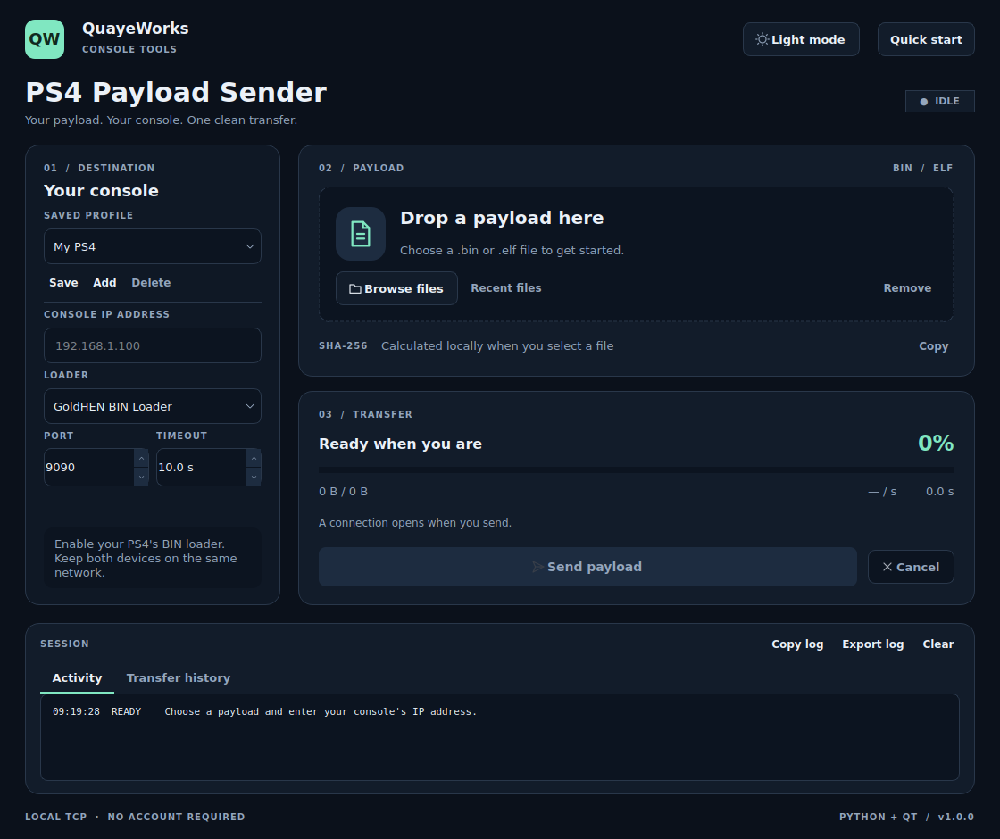

# Payload-Sender

**Payload-Sender** is a modern Python application for sending PS4 homebrew payloads to a TCP BIN loader. Its PySide6 desktop interface provides a simple workflow: choose your console, select a payload, and send it with live feedback.



## Features

- **Modern desktop interface** with dark and light themes.
- **Drag-and-drop** and file browsing for `.bin` and `.elf` payloads.
- **Saved console profiles** with configurable IP address, port, and timeout.
- **Live transfer progress** with byte count, speed, and elapsed time.
- **Responsive cancellation** during file preparation, connection, and transfer.
- **Local SHA-256 checksums** and a verified file snapshot for transmission.
- **Recent files and transfer history** for convenient repeat use.
- **Activity logs** with clipboard copying and file export.
- **Command-line mode** with optional JSON output.

## Requirements

- Python **3.10 or newer** for running from source.
- A PS4 with a compatible TCP BIN loader enabled.
- A PC and PS4 connected to the same network.
- A payload compatible with your console firmware and loader.

## Installation

### Windows

1. Install Python from [python.org](https://www.python.org/downloads/). Enable **Add Python to PATH** during installation.
2. Download and extract this repository into a writable folder.
3. Double-click **Start_Windows.bat**.

The launcher creates a local Python environment and installs the desktop dependency on first use. Internet access is required for that initial setup; subsequent launches reuse the environment.

### Linux and macOS

From the project folder, run:

```bash
python3 bootstrap.py
```

Linux desktop systems may also need their normal Qt/XCB system libraries.

### Manual installation

Inside your preferred Python environment:

```bash
python -m pip install -r requirements.txt
python main.py
```

## Usage

1. Enable the BIN loader on your PS4.
2. Enter the console's IP address and the loader's listening port.
3. Browse for a payload or drag it into the app.
4. Click **Send payload** and verify the result on your PS4.

| Loader preset | Port |
| --- | --- |
| GoldHEN BIN Loader | `9090` |
| Alternative raw TCP loader | `9020` |
| Custom | Enter the port used by your loader |

Use the port your loader actually listens on. The [GoldHEN documentation](https://github.com/GoldHEN/GoldHEN#features) lists its BIN Loader on port `9090`.

Each send opens a fresh connection and transmits the payload's raw bytes. **Transfer complete** means all bytes were submitted to TCP; the protocol does not confirm payload execution. The loader must support the selected file format, including `.elf` when used.

After a partial or canceled transfer, check the console and reset the loader if needed before resending. The app does not automatically retry payloads.

## Command-line usage

The CLI requires only the Python standard library; Qt is needed for the desktop interface.

```bash
python main.py --cli --host 192.168.1.100 --port 9090 payload.bin
```

For JSON output and a configurable connection/stall timeout:

```bash
python main.py --cli --json --host 192.168.1.100 --port 9090 --timeout 10 payload.bin
```

Use a literal IPv4 or IPv6 address. Press **Ctrl+C** to cancel. JSON responses include the transfer result and byte count; successful sends report `execution_confirmed: false`.

## Keyboard shortcuts

| Shortcut | Action |
| --- | --- |
| Ctrl+O | Browse for a payload |
| Ctrl+Enter | Send the selected payload |
| Esc | Cancel the current operation |
| Ctrl+L | Clear the session log |

## Build a Windows executable

Run **Build_Windows.bat** on Windows. It installs PyInstaller and creates a distribution under `dist/`.

Keep the entire generated application folder together when moving it to another PC. The packaged app includes its Python and Qt runtime, so the receiving PC does not need Python installed.

The source package contains launch and build scripts. A Windows executable must be built and verified on Windows.

## Testing

```bash
python -m unittest discover -v
```

Version 1.0.0 passed **30 automated tests on Linux**, covering exact-byte transfers, timeouts, cancellation, file validation, settings, and desktop workflows. A native Linux package also passed startup and loopback-transfer checks. PS4 hardware testing and Windows/macOS validation remain pending. See [VALIDATION.md](VALIDATION.md) for details.

## Troubleshooting

| Problem | What to check |
| --- | --- |
| Send button disabled | Select a valid payload and enter a valid console IP address |
| Connection refused | Enable the BIN loader and check its port |
| Connection timed out | Check the IP address, network connection, and firewall |
| Transfer stalled or canceled | Check the console and reset the loader before resending |
| File changed | Select the payload again to inspect its current content |
| Transfer complete, no console result | Confirm payload compatibility and verify execution on the PS4 |

## Local data

Console profiles, theme, recent files, and transfer history are saved locally. The app requires no account and performs no background console scans. Use **Export log** to save session diagnostics.

## Credits and license

Developed for **QuayeWorks** as a fresh Python implementation of the PS4 payload-sender workflow. Credits to [valentinbreiz](https://github.com/valentinbreiz/PS4-Payload-Sender) for the original sender and **HIASQ** for the supplied C# fork.

The new application code is licensed under the **MIT License**. See [LICENSE](LICENSE) and [NOTICE.md](NOTICE.md) for license and dependency notices.
